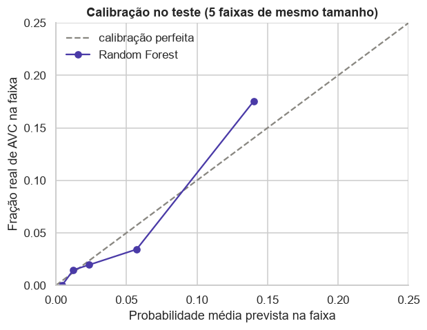

# Discussão crítica

Seção 4 da APS2. Os números de apoio são calculados no [notebook 04](https://github.com/mthperera/APS-ML/blob/main/notebooks/04_evaluation.ipynb).

## Limitações do modelo

### 1. O modelo depende de um sinal que não se repete no teste

O indicador de IMC ausente, criado na APS1 porque a falta do IMC estava associada ao AVC, é a 3ª feature mais importante da floresta. Na validação cruzada, tirá-lo derrubava a PR-AUC de 0,264 para 0,195 ([Modelagem](modeling.md#5-mudanca-no-pipeline)). No teste, o sinal quase desaparece:

| | Pacientes sem IMC | AVC entre eles | Taxa de AVC sem IMC | Taxa de AVC com IMC |
|---|---|---|---|---|
| Treino | 163 | 37 | **22,7%** | 4,1% |
| Teste | 38 | 3 | **7,9%** | 4,8% |

- Para esses 38 pacientes, o modelo prevê em média 13,8% de AVC, quase o dobro do real, e sinaliza 24 deles.
- Como diagnóstico, a mesma floresta sem o indicador, treinada no treino, teria PR-AUC de **0,264 no teste**, contra 0,214 com ele. Isso explica a maior parte da queda entre validação cruzada (0,269) e teste.
- **O modelo final não é trocado por causa disso:** escolher o pipeline sem o indicador agora seria selecionar modelo pelo teste, e o 0,264 deixaria de ser uma estimativa honesta. Com só 163 pacientes sem IMC no treino, a diferença pode ser em parte acaso, mas um sinal tão forte, sem explicação clínica e instável entre amostras, não deveria sustentar um modelo em produção. A próxima versão deveria ser desenvolvida sem o indicador, ou com ele validado em dados novos.

### 2. O ponto de operação só vale para a prevalência desta amostra

Recall e especificidade são propriedades do modelo, mas a precisão depende da proporção de AVC na população. Mantendo o recall (0,660) e a especificidade (0,838) do teste, pelo teorema de Bayes:

| Prevalência | Precisão | Alertas por caso de AVC |
|---|---|---|
| 4,9% (esta amostra) | 0,174 | 5,8 |
| 2% | 0,077 | 13 |
| 1% | 0,040 | 25 |
| 0,5% | 0,020 | 50 |
| 0,15% (incidência anual global) | 0,006 | 164 |

Nesta amostra, as probabilidades são razoavelmente calibradas: na faixa mais alta o modelo prevê 0,14 para uma fração real de 0,175. Mas essa calibração está presa à prevalência de 4,9%, que mostra que a amostra não é uma população geral: na população, com cerca de 150 AVCs por 100 mil pessoas por ano (Feigin et al., 2021), o mesmo modelo emitiria mais de 160 alertas por caso, e as probabilidades ficariam superestimadas (Van Calster et al., 2019). Usar o modelo em outra população exige recalibrar as probabilidades e escolher de novo o limiar com dados dessa população.

## Limitações dos dados

### 1. Os dados são transversais: o target é histórico de AVC, não AVC futuro

Não há datas, então não se sabe se hipertensão, glicose, IMC ou tabagismo foram medidos antes ou depois do AVC. Quem teve AVC pode ter passado a tratar a pressão, mudado a dieta ou parado de fumar ("ex-fumante" pode ser consequência). O modelo aprende associações com quem *teve* AVC, não fatores que o *precedem*, e não pode ser usado como previsão de risco futuro. Para isso são necessários dados longitudinais, como os da coorte de Framingham, base dos escores clássicos de risco de AVC (Wolf et al., 1991). A instabilidade do IMC ausente é compatível com isso: a falta de um peso medido pode refletir como cada paciente chegou ao registro (por exemplo, internado após o AVC), e não uma característica dele.

### 2. Faltam fatores de risco centrais

O estudo INTERSTROKE identificou dez fatores de risco modificáveis responsáveis por cerca de 90% do risco populacional de AVC: hipertensão, atividade física, relação ApoB/ApoA1, dieta, relação cintura-quadril, fatores psicossociais, tabagismo, causas cardíacas (como fibrilação atrial), álcool e diabetes (O'Donnell et al., 2016). O dataset tem versões grosseiras de poucos deles:

| Fator de risco | No dataset |
|---|---|
| hipertensão | só sim/não, sem a pressão medida |
| causas cardíacas | "doença cardíaca" genérica, sem distinguir fibrilação atrial |
| diabetes | glicose média, sem diagnóstico |
| obesidade abdominal | IMC, em vez da relação cintura-quadril |
| colesterol, atividade física, dieta, álcool, estresse | ausentes |

Isso explica o teto visto na curva de aprendizado (o modelo fica em 0,45 de PR-AUC até no treino) e os falsos negativos sem nenhum fator registrado.

## Operacionalização e manutenção

### 1. Monitorar entradas e desempenho, com recalibração e re-treino programados

Em produção, a distribuição das entradas muda (outra população, novos protocolos de coleta) e o desempenho cai sem aviso; é um dos principais custos ocultos de sistemas de ML (Sculley et al., 2015). Na prática:

- comparar todo mês a distribuição de cada feature com a do treino, por testes univariados (Kolmogorov-Smirnov nas contínuas, qui-quadrado nas categóricas, com correção de Bonferroni), que Rabanser et al. (2019) mostraram ser um detector de mudança simples e eficaz. A taxa de IMC ausente e a taxa de AVC nesse grupo merecem alarme próprio;
- acompanhar a taxa de alertas (19% no teste): uma mudança brusca indica mudança na população ou no fluxo de dados antes mesmo de os desfechos chegarem;
- quando os desfechos reais chegarem, recalcular recall, precisão e calibração; abaixo de um recall mínimo acordado (por exemplo, 53%, o limite inferior do intervalo de confiança do teste), recalibrar ou retreinar com os dados novos.

### 2. Versionar o pipeline como um artefato único, com um model card

O objeto salvo pelo notebook 03 já reúne pré-processamento, modelo e limiar. Ele deve ser versionado junto com os dados e o código que o geraram, para que toda predição seja rastreável a uma versão e um re-treino possa ser desfeito. Cada versão deve vir com um model card (Mitchell et al., 2019) que registre a população em que o modelo vale, as métricas com intervalos de confiança, o limiar e o motivo da escolha, e as limitações desta página.

## Referências

- Bergstra, J., & Bengio, Y. (2012). Random search for hyper-parameter optimization. *Journal of Machine Learning Research*, 13, 281–305.
- Breiman, L. (2001). Random forests. *Machine Learning*, 45(1), 5–32.
- Cawley, G. C., & Talbot, N. L. C. (2010). On over-fitting in model selection and subsequent selection bias in performance evaluation. *Journal of Machine Learning Research*, 11, 2079–2107.
- Collins, G. S., Ogundimu, E. O., & Altman, D. G. (2016). Sample size considerations for the external validation of a multivariable prognostic model: a resampling study. *Statistics in Medicine*, 35(2), 214–226.
- fedesoriano (2021). *Stroke Prediction Dataset*. Kaggle. https://www.kaggle.com/datasets/fedesoriano/stroke-prediction-dataset
- Feigin, V. L. et al. (GBD 2019 Stroke Collaborators) (2021). Global, regional, and national burden of stroke and its risk factors, 1990–2019: a systematic analysis for the Global Burden of Disease Study 2019. *The Lancet Neurology*, 20(10), 795–820.
- Lundberg, S. M., & Lee, S.-I. (2017). A unified approach to interpreting model predictions. *Advances in Neural Information Processing Systems*, 30.
- Lundberg, S. M., Erion, G., Chen, H. et al. (2020). From local explanations to global understanding with explainable AI for trees. *Nature Machine Intelligence*, 2(1), 56–67.
- Mitchell, M. et al. (2019). Model cards for model reporting. *Proceedings of the Conference on Fairness, Accountability, and Transparency (FAT\* '19)*, 220–229.
- Nadeau, C., & Bengio, Y. (2003). Inference for the generalization error. *Machine Learning*, 52(3), 239–281.
- O'Donnell, M. J. et al. (2016). Global and regional effects of potentially modifiable risk factors associated with acute stroke in 32 countries (INTERSTROKE): a case-control study. *The Lancet*, 388(10046), 761–775.
- Pedregosa, F. et al. (2011). Scikit-learn: machine learning in Python. *Journal of Machine Learning Research*, 12, 2825–2830.
- Rabanser, S., Günnemann, S., & Lipton, Z. C. (2019). Failing loudly: an empirical study of methods for detecting dataset shift. *Advances in Neural Information Processing Systems*, 32.
- Saito, T., & Rehmsmeier, M. (2015). The precision-recall plot is more informative than the ROC plot when evaluating binary classifiers on imbalanced datasets. *PLoS ONE*, 10(3), e0118432.
- Sculley, D. et al. (2015). Hidden technical debt in machine learning systems. *Advances in Neural Information Processing Systems*, 28, 2503–2511.
- Strobl, C., Boulesteix, A.-L., Zeileis, A., & Hothorn, T. (2007). Bias in random forest variable importance measures: illustrations, sources and a solution. *BMC Bioinformatics*, 8, 25.
- Tibshirani, R. (1996). Regression shrinkage and selection via the lasso. *Journal of the Royal Statistical Society: Series B*, 58(1), 267–288.
- Van Calster, B., McLernon, D. J., van Smeden, M., Wynants, L., & Steyerberg, E. W. (2019). Calibration: the Achilles heel of predictive analytics. *BMC Medicine*, 17, 230.
- van Rijsbergen, C. J. (1979). *Information Retrieval* (2ª ed.). Butterworths.
- Wolf, P. A., D'Agostino, R. B., Belanger, A. J., & Kannel, W. B. (1991). Probability of stroke: a risk profile from the Framingham Study. *Stroke*, 22(3), 312–318.
- Zou, H., & Hastie, T. (2005). Regularization and variable selection via the elastic net. *Journal of the Royal Statistical Society: Series B*, 67(2), 301–320.
