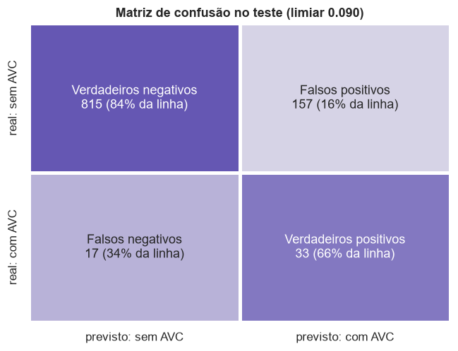
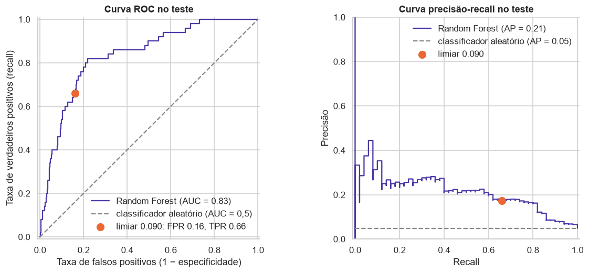

# Avaliação no teste

Seção 2 da APS2. O código completo está no [notebook 04](https://github.com/mthperera/APS-ML/blob/main/notebooks/04_evaluation.ipynb). O conjunto de teste (1.022 pacientes, 50 casos de AVC), separado na tarefa 1.7 da APS1, é usado aqui pela primeira vez, e nenhuma decisão de modelagem foi tomada a partir dele.

Modelo avaliado: a Random Forest final da página [Modelagem](modeling.md), com o pipeline novo e limiar 0,090.

## 1. Métricas

| | Accuracy | Precision | Recall | F1-score | ROC-AUC | PR-AUC |
|---|---|---|---|---|---|---|
| Dummy (sempre "sem AVC") | 0,951 | 0,000 | 0,000 | 0,000 | 0,500 | 0,049 |
| Random Forest, limiar padrão 0,5 | 0,951 | 0,000 | 0,000 | 0,000 | 0,835 | 0,214 |
| **Random Forest, limiar 0,090 (modelo final)** | 0,830 | **0,174** | **0,660** | **0,275** | **0,835** | **0,214** |

- **A acurácia engana:** o Dummy e a floresta com limiar 0,5 acertam 95,1% e não encontram nenhum AVC. O modelo final tem acurácia menor justamente porque sinaliza pacientes.
- **Recall de 0,66:** encontra 33 dos 50 AVCs.
- **Precisão de 0,17:** cerca de 1 em cada 6 alertas é AVC. É 3,6 vezes a prevalência: o grupo sinalizado tem risco 3,6 vezes maior que o paciente médio.
- **Teste contra validação cruzada:** ROC-AUC 0,835 contra 0,853, PR-AUC 0,214 contra 0,269. A queda está dentro da variação entre dobras e é esperada com só 50 casos. Recall e precisão ficaram perto do previsto (0,67 e 0,18): o limiar escolhido no treino se transferiu bem.

## 2. Matriz de confusão

| | Previsto: sem AVC | Previsto: com AVC |
|---|---|---|
| **Real: sem AVC** | 815 verdadeiros negativos | 157 falsos positivos |
| **Real: com AVC** | 17 falsos negativos | 33 verdadeiros positivos |

Quem são os erros:

| Grupo | Pacientes | Idade mediana | Glicose mediana | Hipertensão | Doença cardíaca |
|---|---|---|---|---|---|
| Verdadeiros positivos | 33 | 78 | 133 | 33% | 33% |
| **Falsos negativos** | 17 | 57 | 93 | 6% | 0% |
| **Falsos positivos** | 157 | 74 | 151 | 40% | 14% |
| Verdadeiros negativos | 815 | 38 | 89 | 4% | 1% |

- **Falsos negativos** são AVCs atípicos: mais jovens e quase sem fatores de risco registrados. As features disponíveis não os distinguem de pacientes saudáveis.
- **Falsos positivos** têm o perfil de risco dos verdadeiros positivos: são pacientes de alto risco que não tiveram AVC (ou ainda não tiveram). Em triagem, é o erro aceitável, porque são justamente os que se beneficiariam de acompanhamento.
- **Custo prático:** para encontrar 33 dos 50 casos, o modelo sinaliza 190 pacientes (19% do teste), quase 6 alertas por caso verdadeiro.

## 3. Curva ROC

**ROC-AUC = 0,835:** em 83,5% dos pares (paciente com AVC, paciente sem AVC), o paciente com AVC recebe probabilidade maior. Com 20% de falsos positivos a curva já chega a ~80% de recall, e o ponto de operação (16% de falsos positivos, 66% de recall, em laranja) fica nesse trecho de melhor custo-benefício.

A curva precisão-recall mostra o outro lado: a precisão fica entre 0,2 e 0,3 até 40% de recall e cai depois. É o efeito do desbalanceamento: 16% de falsos positivos parece pouco, mas são 157 pacientes, quase 5 vezes os 33 verdadeiros positivos. Por isso a PR-AUC foi a métrica de seleção.
