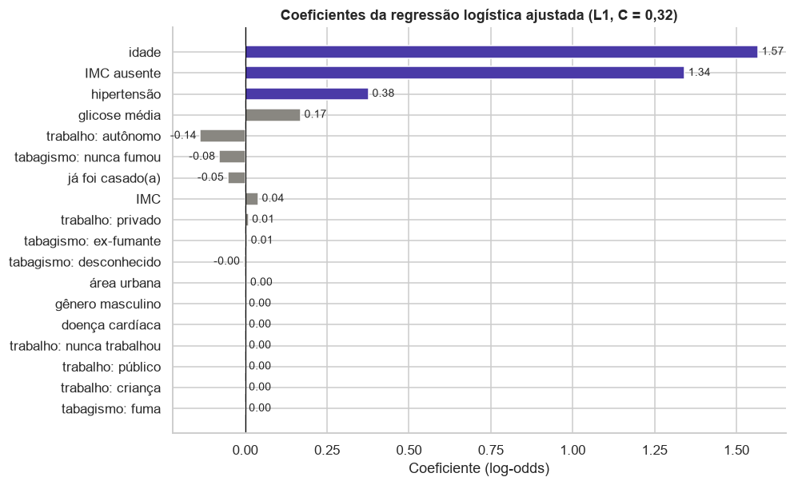
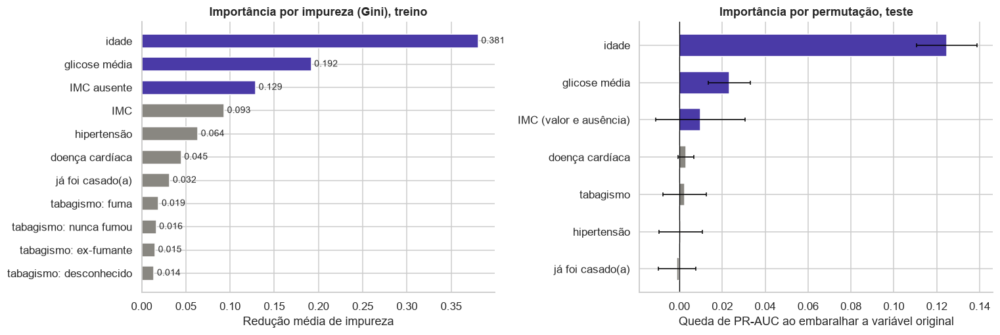
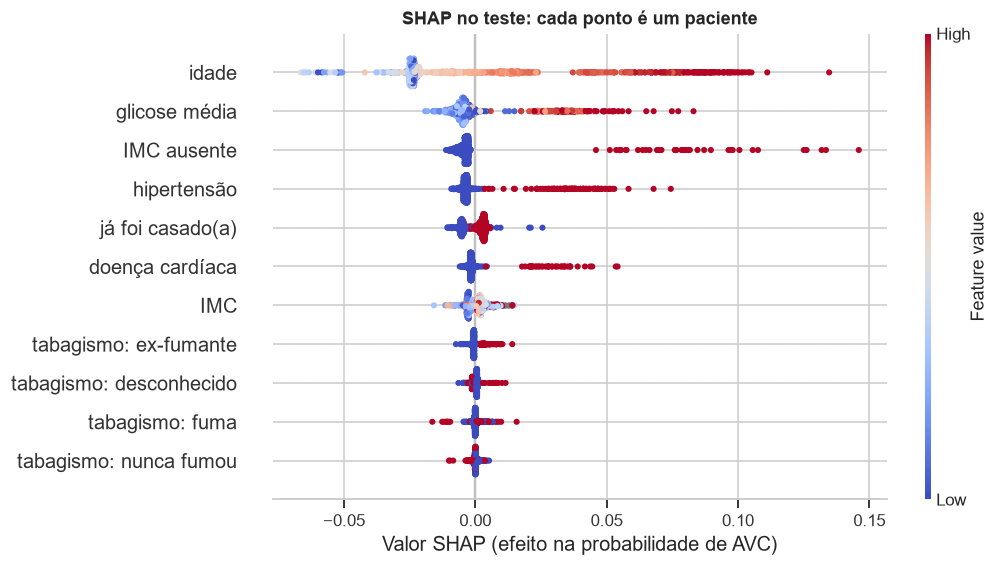
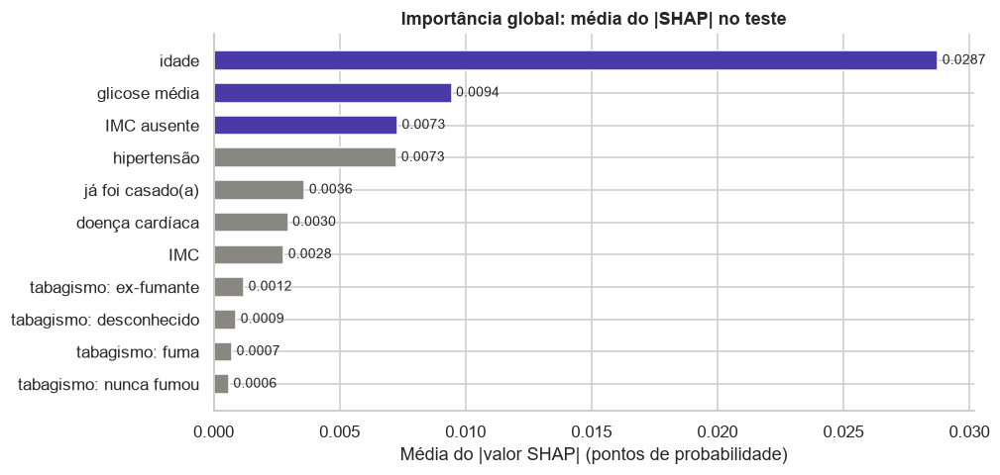
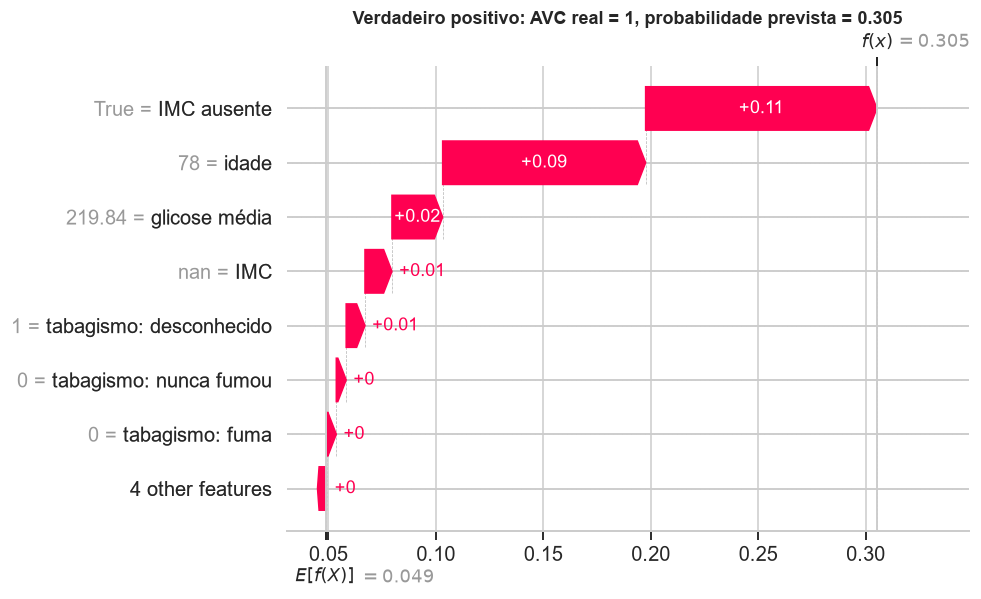
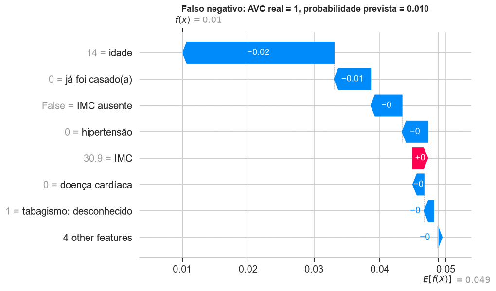
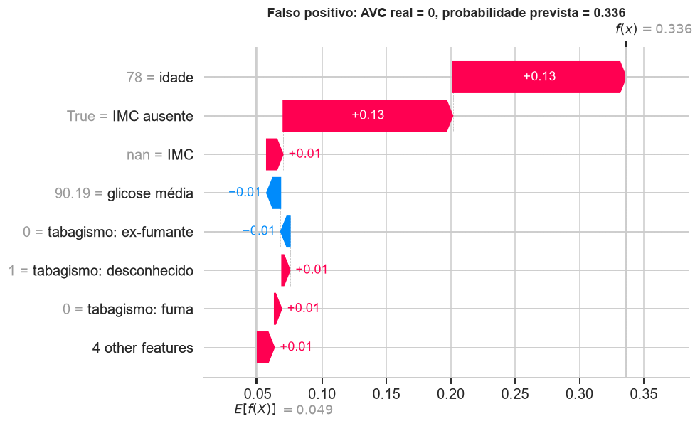

# Interpretação

Seção 3 da APS2. O código completo está no [notebook 04](https://github.com/mthperera/APS-ML/blob/main/notebooks/04_evaluation.ipynb). Três olhares sobre o que os modelos aprenderam: os coeficientes da regressão logística, as importâncias da Random Forest e os valores SHAP do modelo final.

## 1. Regressão logística: os 3 maiores coeficientes

Modelo: a regressão logística ajustada (L1, C = 0,32) com o pipeline da APS1. As contínuas estão padronizadas, então o coeficiente mede o efeito de +1 desvio padrão; as binárias medem ter contra não ter. exp(coef) é a razão de chances.

| Feature | Coeficiente | Razão de chances | Leitura |
|---|---|---|---|
| **idade** | 1,57 | 4,8 | cada 22,6 anos a mais multiplicam a chance de AVC por 4,8 |
| **IMC ausente** | 1,34 | 3,8 | sem IMC registrado, a chance é 3,8 vezes maior |
| **hipertensão** | 0,38 | 1,5 | hipertensos têm chance 46% maior, já descontada a idade |

- A **idade** é de longe o maior efeito, como a APS1 antecipava (mediana de 70 anos nos casos contra 43).
- O **IMC ausente** não é efeito biológico: é o sinal da APS1 (19,9% de AVC entre quem não tem IMC), preservado pelo indicador criado no pré-processamento. A página [Discussão crítica](discussion.md) trata do que isso diz sobre a coleta.
- A **hipertensão** confirma a APS1, em que elevava a taxa de AVC em todas as faixas etárias.

A penalidade L1 zerou 6 dos 18 coeficientes, entre eles gênero e três colunas de trabalho: a mesma direção da mudança de pipeline, encontrada de forma independente. Também zerou a doença cardíaca; com L1, entre features que se sobrepõem, o modelo tende a manter uma e zerar as outras, e parte do efeito dela já está na idade e na hipertensão. O zero não quer dizer que ela não importa. Ressalva: +1 desvio padrão de idade e ter hipertensão são unidades diferentes, então a ordem entre contínuas e binárias depende da escala.

## 2. Random Forest: as 3 features mais importantes

| Feature | Importância por impureza |
|---|---|
| **idade** | 0,381 |
| **glicose média** | 0,192 |
| **IMC ausente** | 0,129 |

A importância por impureza (à esquerda) é calculada no treino e favorece variáveis contínuas, que oferecem mais pontos de corte (Strobl et al., 2007). Por isso ela é conferida com a importância por permutação no teste (à direita), que mede quanto a PR-AUC cai quando uma variável original é embaralhada.

- A permutação confirma a **idade** como dominante (queda de 0,12 na PR-AUC, mais da metade do valor do modelo) e a **glicose** em segundo (0,02). O grupo com glicose alta, mantido como outlier na APS1, é o segundo sinal mais forte.
- O **IMC contínuo** é o 4º por impureza (0,093), mas embaralhá-lo tem efeito pequeno e instável: é o viés da impureza aparecendo.
- Hipertensão e doença cardíaca, sozinhas, acrescentam pouco a um modelo que já sabe a idade e a glicose.

## 3. SHAP

SHAP divide a diferença entre a predição de um paciente e a predição média entre as features, usando os valores de Shapley (Lundberg & Lee, 2017); para florestas, o TreeExplainer calcula esses valores de forma exata (Lundberg et al., 2020). Aqui eles estão na escala de probabilidade: valor base (0,049) + soma dos SHAP = probabilidade prevista, verificado no notebook com erro máximo de 6 × 10⁻¹⁶.

### Importância global

A ordem pela média do |SHAP| é idade, glicose, IMC ausente e hipertensão: as três primeiras coincidem com a importância por impureza. O beeswarm mostra também direção e forma:

| Feature | Efeito |
|---|---|
| idade | idades baixas tiram até ~0,07 da probabilidade; idades altas somam até ~0,13. O efeito acelera nos mais velhos, a não linearidade que a APS1 descrevia |
| glicose | só valores altos empurram para cima; os normais quase não mexem. É um efeito de limiar, que a regressão logística (linear na glicose) não captura |
| IMC ausente | soma entre +0,05 e +0,15 quando presente, o maior efeito individual do modelo |
| hipertensão e doença cardíaca | ter a condição soma até ~0,07; não ter quase não muda nada |
| IMC e tabagismo | efeitos pequenos e misturados |

### Três predições individuais

Escolhidos para cobrir o acerto e os dois tipos de erro. Cada gráfico parte do valor base (embaixo) e soma as contribuições até a probabilidade prevista (em cima).

**Verdadeiro positivo:** homem, 78 anos, doença cardíaca, glicose 220, sem IMC registrado. Probabilidade 0,305, 6 vezes a média.

IMC ausente (+0,11), idade (+0,09) e glicose (+0,02) explicam a predição. É o perfil de alto risco da APS1. A doença cardíaca quase não contribui: nas árvores rasas, idade e glicose já separam esse paciente.

**Falso negativo:** menina, 14 anos, sem hipertensão nem doença cardíaca, glicose 58. Probabilidade 0,010.

A idade tira 0,02 e nunca ter casado (que nessa idade é também idade) tira 0,01. É um dos dois AVCs antes dos 20 anos do dataset, apontados como suspeitos na APS1. Nada nos dados a distingue de outros adolescentes saudáveis, e pode ser erro de registro.

**Falso positivo:** homem, 78 anos, hipertenso, glicose 90, sem IMC registrado. Probabilidade 0,336, a maior entre os pacientes sem AVC do teste.

Idade (+0,13) e IMC ausente (+0,13) explicam quase tudo. Metade da probabilidade vem da falta de um dado, que pesa tanto quanto ter 78 anos.

O verdadeiro positivo e o falso positivo recebem probabilidades parecidas pelos mesmos motivos, e só um teve AVC: o modelo ordena risco, mas não diagnostica.
