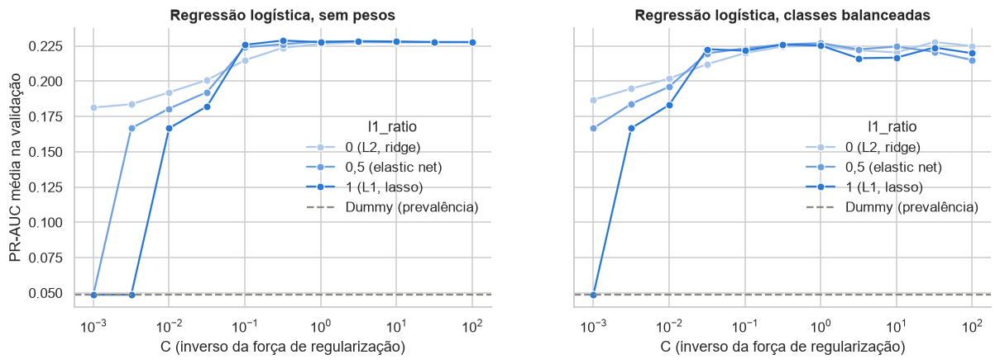
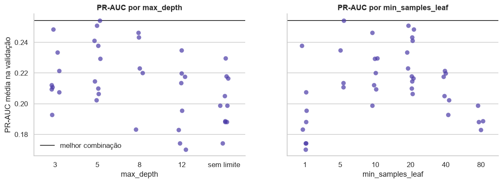
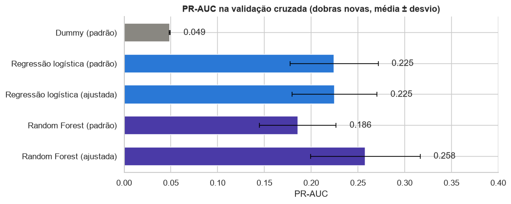
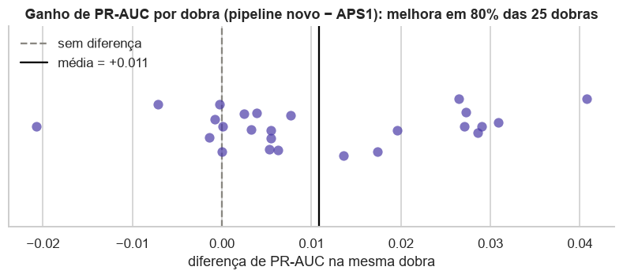
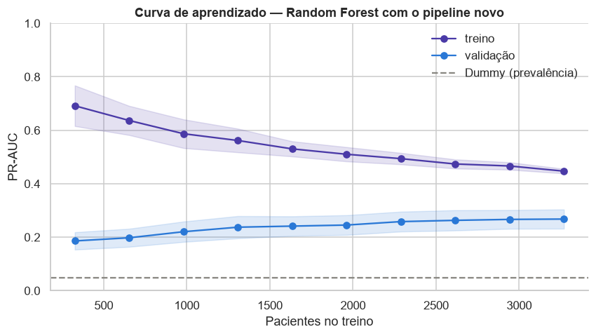
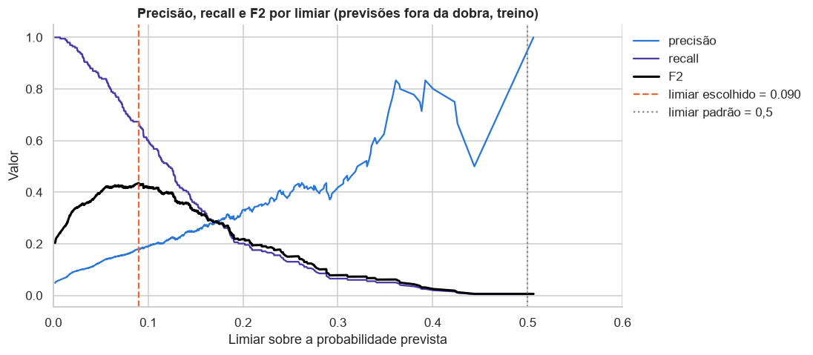

# Modelagem

Seção 1 da APS2. O código completo está no [notebook 03](https://github.com/mthperera/APS-ML/blob/main/notebooks/03_modeling.ipynb). Tudo nesta página usa **somente o conjunto de treino** (4.087 pacientes, 199 casos de AVC); o teste só é usado na página [Avaliação no teste](evaluation.md).

Convenção de cores dos gráficos: **cinza** é o Dummy, **azul** é a regressão logística e **violeta** é a Random Forest.

## Ponto de partida: o pipeline da APS1

O pré-processador da [APS1](preprocessing.md) é reaproveitado sem alterações (imputação do IMC com indicador de ausência, log na glicose, limite de 60 no IMC, one-hot e padronização), agora como primeiro passo de um `Pipeline` junto com o modelo:

```python
def criar_pipeline(modelo, categoricas=CAT_COLS):
    return Pipeline([("prep", criar_preprocessador(categoricas)), ("modelo", modelo)])
```

Assim, em cada dobra da validação cruzada, as medianas, médias, desvios e categorias são reaprendidos só com a parte de treino da dobra, e a dobra de validação nunca contamina o pré-processamento.

## 1. Métrica e estratégia de validação

**Métrica escolhida: PR-AUC (average precision)**, a área sob a curva precisão-recall da classe AVC.

| Alternativa | Por que não foi a métrica principal |
|---|---|
| Acurácia | com 4,9% de AVC, prever sempre "sem AVC" acerta 95,1% |
| F1, precisão ou recall | dependem de um limiar, que só faz sentido escolher depois de ter o modelo (seção 6) |
| ROC-AUC | usa a taxa de falsos positivos, cujo denominador são os ~3.900 pacientes sem AVC; pode ficar alta mesmo quando a maioria dos alertas é falsa (Saito & Rehmsmeier, 2015). É reportada como métrica secundária |

A PR-AUC mede se o modelo ordena os pacientes com AVC acima dos demais, olhando só para a classe rara, e tem referência clara: um modelo sem informação tem PR-AUC igual à prevalência (0,049).

**Validação:** 5 dobras estratificadas repetidas 3 vezes (15 avaliações), com cerca de 40 casos de AVC em cada dobra de validação. As repetições reduzem a variância da estimativa, que é alta com tão poucos positivos. O mesmo objeto de validação é usado em todas as buscas. Para comparar modelos já ajustados, um segundo esquema (5 × 5, outra semente) avalia em dobras que a busca não viu, porque a melhor nota de uma busca é otimista: é o máximo entre muitas combinações (Cawley & Talbot, 2010).

## 2. Os três modelos

| Modelo | Por que |
|---|---|
| **Dummy** (`strategy="prior"`) | prevê a prevalência do treino para todos; é o piso que qualquer modelo útil precisa superar |
| **Regressão logística** (com regularização) | modelo linear de referência em risco clínico, com coeficientes interpretáveis; o padrão do scikit-learn já usa L2 com C = 1 |
| **Random Forest** (ensemble de árvores) | captura não linearidades e interações, como a glicose alta pesando mais em idosos (APS1), e reduz a variância de uma árvore isolada tirando a média de muitas (Breiman, 2001) |

Com os hiperparâmetros padrão:

| Modelo | PR-AUC treino | PR-AUC validação | ROC-AUC validação |
|---|---|---|---|
| Dummy | 0,049 | 0,049 | 0,500 |
| Regressão logística | 0,237 | 0,227 | 0,851 |
| Random Forest | **1,000** | 0,180 | 0,806 |

A regressão logística já é 4,6 vezes o Dummy e não está sobreajustada (treino e validação próximos). A Random Forest padrão decora o treino: árvores sem limite de profundidade e folhas de um paciente memorizam os 199 casos de AVC, e o que memorizam é em boa parte ruído.

## 3. Seleção de hiperparâmetros

### Regressão logística: GridSearchCV

| Hiperparâmetro | Valores | Por quê |
|---|---|---|
| C | 11 valores de 0,001 a 100, escala log | inverso da força da regularização |
| l1_ratio | 0 (L2), 0,5 (elastic net), 1 (L1) | L2 encolhe os coeficientes; L1 pode zerá-los, selecionando features (Tibshirani, 1996); elastic net combina os dois (Zou & Hastie, 2005) |
| class_weight | nenhum, balanceado | o balanceado dá a cada AVC peso ~20 vezes maior |

São 66 combinações; como a regressão treina em menos de um segundo, a busca exaustiva é viável.



A PR-AUC só cai com regularização forte (C ≤ 0,03); com L1 e C = 0,001 todos os coeficientes são zerados e o modelo vira o Dummy. De C = 0,1 em diante a curva é plana: com 4.087 pacientes para 18 features há pouco sobreajuste para corrigir. O melhor ponto (**L1, C = 0,32, sem pesos**, PR-AUC 0,229) fica dentro do ruído do padrão. Pesar as classes não ajuda, porque muda a escala das probabilidades mas quase não muda a ordem dos pacientes, que é o que a PR-AUC mede.

### Random Forest: RandomizedSearchCV

| Hiperparâmetro | Valores | Por quê |
|---|---|---|
| max_depth | 3, 5, 8, 12, sem limite | limita o quanto cada árvore decora o treino |
| min_samples_leaf | 1, 5, 10, 20, 40, 80 | folhas maiores dão probabilidades menos ruidosas |
| max_features | raiz, 30%, 50%, 100% | menos features por divisão deixam as árvores mais diferentes entre si |
| class_weight | nenhum, balanced, balanced_subsample | mesma ideia da regressão logística |

O número de árvores fica fixo em 300 (mais árvores não pioram a floresta, só deixam o treino mais lento). Das 360 combinações, a busca aleatória testa 40: quando poucos hiperparâmetros importam de fato, poucos sorteios cobrem bem o espaço (Bergstra & Bengio, 2012).



Melhor combinação: **profundidade 5, folhas de pelo menos 5 pacientes, raiz quadrada das features, sem peso de classe** (PR-AUC 0,254). Árvores sem limite e folhas de 1 paciente ficam no fundo do gráfico: a busca corrigiu exatamente o sobreajuste da seção anterior.

## 4. Comparação dos modelos

Os cinco candidatos reavaliados em 25 dobras novas:



| Modelo | PR-AUC treino | PR-AUC validação | Desvio | ROC-AUC validação |
|---|---|---|---|---|
| Dummy | 0,049 | 0,049 | 0,000 | 0,500 |
| Regressão logística, padrão | 0,237 | 0,225 | 0,047 | 0,849 |
| Regressão logística, ajustada | 0,232 | 0,225 | 0,045 | 0,851 |
| Random Forest, padrão | 1,000 | 0,186 | 0,041 | 0,814 |
| **Random Forest, ajustada** | 0,455 | **0,258** | 0,059 | 0,851 |

A **Random Forest ajustada é o melhor modelo**. A busca rendeu +0,072 para ela e nada para a regressão logística, que não estava sobreajustada. As duas empatam em ROC-AUC; a PR-AUC, que olha para a classe rara, é que as separa. A vantagem (0,033) é menor que o desvio entre dobras: existe na média, mas é modesta.

## 5. Mudança no pipeline

**Proposta:** remover três variáveis que a APS1 mostrou não terem sinal próprio.

| Variável | Evidência na APS1 |
|---|---|
| gender | V de Cramér 0,010, p = 0,53 |
| Residence_type | V de Cramér 0,017, p = 0,28 |
| work_type | a associação some dentro das faixas etárias: é um proxy de idade |

O estado civil fica, porque acima dos 60 anos ainda mostra diferença (20,0% contra 12,7%), e o tabagismo fica, porque a categoria desconhecida carrega informação.

**Por que deve ajudar a floresta:** com `max_features="sqrt"`, cada divisão sorteia 4 das 18 colunas, e as 7 colunas dessas variáveis são 39% delas. Muitas divisões só têm ruído ou proxies de idade como opção. Com 11 colunas, a raiz sorteia 3, todas com sinal.

**Ablação** (hiperparâmetros da seção 3 fixos):

| Variante | PR-AUC validação |
|---|---|
| pipeline da APS1 (18 features) | 0,254 |
| − gender, Residence_type | 0,261 |
| **− gender, Residence_type, work_type (proposta, 11 features)** | **0,264** |
| − gender, Residence_type, work_type, ever_married | 0,259 |

**Nova seleção de hiperparâmetros**, com mesma métrica, mesmo espaço, mesmo número de sorteios e mesmas dobras: a busca chega aos mesmos hiperparâmetros e a PR-AUC sobe de 0,254 para 0,264 nas dobras da busca e de **0,258 para 0,269** nas dobras novas.



Como os dois pipelines são avaliados nas mesmas 25 dobras, a comparação é pareada: o novo vence em **80% delas**. O ganho é pequeno, como se espera de uma mudança que só tira ruído, e vem com um modelo mais simples: 11 features em vez de 18, três campos a menos para coletar. **O pipeline novo é adotado.**

## 6. Curva de aprendizado



| Pacientes no treino | Casos de AVC | PR-AUC treino | PR-AUC validação |
|---|---|---|---|
| 326 | ~16 | 0,692 | 0,186 |
| 980 | ~48 | 0,587 | 0,221 |
| 1.634 | ~80 | 0,530 | 0,242 |
| 2.288 | ~111 | 0,494 | 0,258 |
| 3.269 | ~159 | 0,447 | 0,268 |

A curva de treino cai e a de validação sobe sem estabilizar. A distância entre elas diminui (de 0,51 para 0,18), mas continua grande: o problema é **variância, não viés**. O modelo é limitado pela quantidade de casos de AVC, não pela capacidade; mais dados, especialmente mais casos positivos, devem melhorar a validação. Aumentar a complexidade não ajudaria: a busca mostrou que árvores mais profundas pioram.

## 7. Limiar de decisão

O limiar padrão de 0,5 não serve: a floresta quase nunca prevê probabilidades tão altas, e com ele sinalizaria 0,02% dos pacientes. O limiar é escolhido para **maximizar o F2**, que dá ao recall peso duas vezes maior que à precisão (van Rijsbergen, 1979). A escolha é clínica: um falso negativo é um paciente de risco que não é encaminhado; um falso positivo é um exame a mais.



| Limiar | Pacientes sinalizados | Precisão | Recall | F1 | F2 |
|---|---|---|---|---|---|
| 0,5 (padrão) | 0,02% | 1,000 | 0,005 | 0,010 | 0,006 |
| 0,125 (máximo F1) | 10,6% | 0,226 | 0,492 | 0,310 | 0,399 |
| **0,090 (máximo F2)** | 18,1% | 0,181 | **0,673** | 0,285 | **0,436** |

O limiar é escolhido com previsões fora da dobra no treino, sem tocar no teste. O F2 é quase plano entre 0,06 e 0,12, então a escolha não depende de um ponto exato.

## Modelo final

Random Forest (300 árvores, profundidade 5, folhas de 5, raiz das features) sobre o pipeline da APS1 sem gender, Residence_type e work_type, com limiar 0,090, reajustada com todo o treino e salva em `models/modelos.joblib` com a regressão logística ajustada e o Dummy.

| Etapa | Resultado |
|---|---|
| Métrica | PR-AUC; ROC-AUC como secundária |
| Dummy | 0,049 |
| Regressão logística | 0,225; a regularização quase não importa |
| Random Forest | de 0,186 para 0,258 com a busca |
| Mudança no pipeline | de 0,258 para 0,269, melhora em 80% das dobras |
| Curva de aprendizado | limitado por dados, não por capacidade |
| Limiar | 0,090: recall de 67% e precisão de 18% na validação |
